<!-- Ported from vercel/streamdown apps/website/content/docs/plugins/mermaid.mdx @ c5e44d8. Copyright 2023 Vercel, Inc. Licensed under the Apache License, Version 2.0. Modified for SolidJS by the solid-streamdown authors. -->

# @solid-streamdown/mermaid

Render Mermaid diagrams including flowcharts, sequence diagrams, and more.

The `@solid-streamdown/mermaid` plugin renders [Mermaid](https://mermaid.js.org/) diagrams including flowcharts, sequence diagrams, state diagrams, and more using text-based syntax. Each diagram includes interactive controls for fullscreen viewing, downloading, and copying.

- Interactive controls (fullscreen, download, copy)
- Custom theming support
- Error handling with retry

## Install

```bash
bun add @solid-streamdown/mermaid
```

```bash
npm i @solid-streamdown/mermaid
```

## Tailwind CSS

### Tailwind v4

Add the following `@source` directive to your `globals.css` or main CSS file:

```css
@source "../node_modules/@solid-streamdown/mermaid/dist/*.js";
```

The path must be relative from your CSS file to the `node_modules` folder containing `@solid-streamdown/mermaid`. In a monorepo, adjust the number of `../` segments to reach the root `node_modules`.

### Tailwind v3

Add `./node_modules/@solid-streamdown/mermaid/dist/*.js` to the `content` array in `tailwind.config.js`, next to your own source globs. In a monorepo, adjust the path to reach the root `node_modules` (for example `../../node_modules/@solid-streamdown/mermaid/dist/*.js`).

## Usage

<!-- example: examples/vite/src/snippets/plugins-mermaid/usage.tsx -->
```tsx
import { mermaid } from "@solid-streamdown/mermaid";
import { Streamdown } from "solid-streamdown";

const markdown = `\`\`\`mermaid
graph TD
    A[Start] --> B{Decision}
    B -->|Yes| C[Success]
    B -->|No| D[Try Again]
    D --> B
\`\`\``;

export default function Chat() {
  return <Streamdown plugins={{ mermaid }}>{markdown}</Streamdown>;
}
```

Without the mermaid plugin, mermaid code blocks render as plain code instead of diagrams.

The diagram component is part of `solid-streamdown` and is imported directly rather than with `lazy()`, so server-rendered markup hydrates without a mismatch; the `mermaid` library itself stays in this plugin package. See [UPSTREAM.md](../../../UPSTREAM.md).

## Basic Usage

Create Mermaid diagrams using code blocks with the `mermaid` language identifier:

````markdown
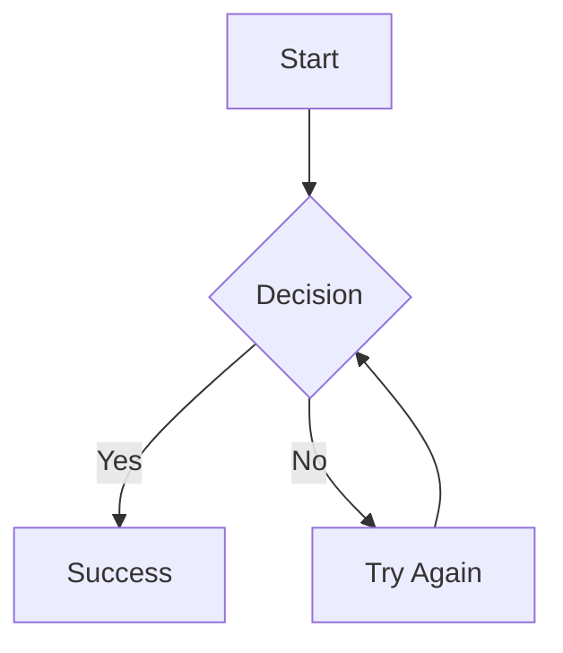
````

Streamdown renders the diagram as an interactive SVG with controls.

## Diagram Types

### Flowcharts

Create flowcharts to visualize processes and workflows:

````markdown
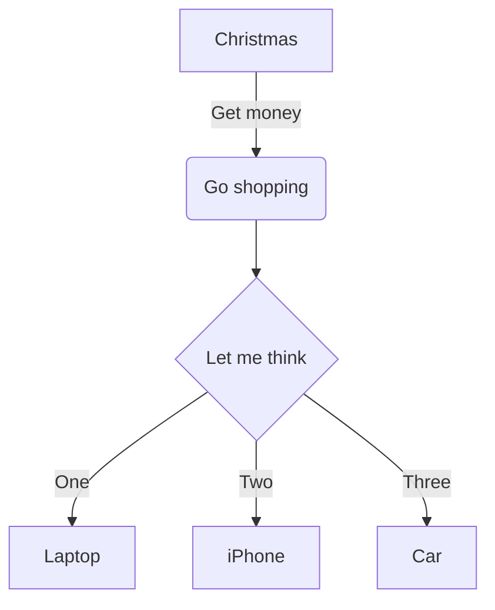
````

**Node Shapes:**

- `[text]` - Rectangle
- `(text)` - Rounded rectangle
- `{text}` - Rhombus (decision)
- `((text))` - Circle
- `[[text]]` - Subroutine shape

**Direction:**

- `graph TD` - Top to bottom
- `graph LR` - Left to right
- `graph BT` - Bottom to top
- `graph RL` - Right to left

### Sequence Diagrams

Visualize interactions between different actors or systems:

````markdown
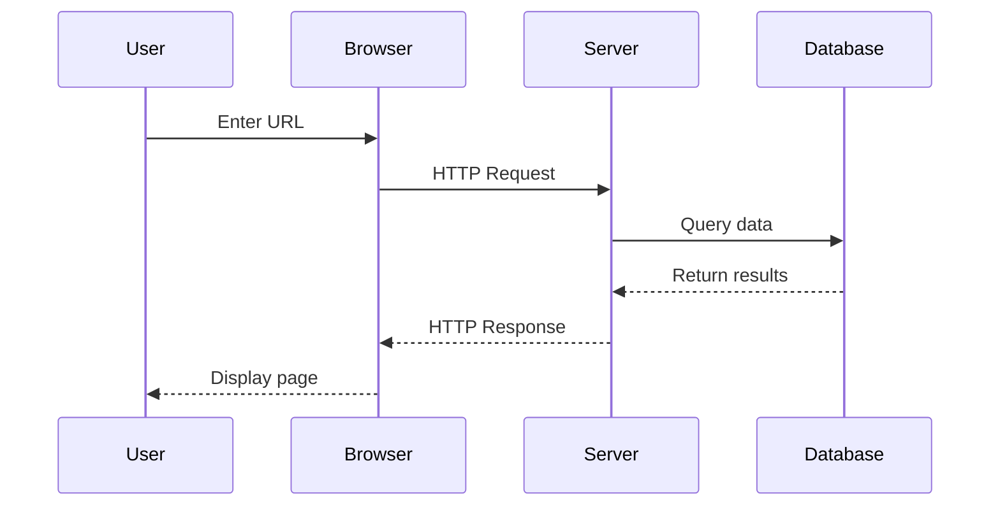
````

**Arrow Types:**

- `->` - Solid line
- `-->` - Dotted line
- `->>` - Solid arrow
- `-->>` - Dotted arrow

### State Diagrams

Model state machines and state transitions:

````markdown
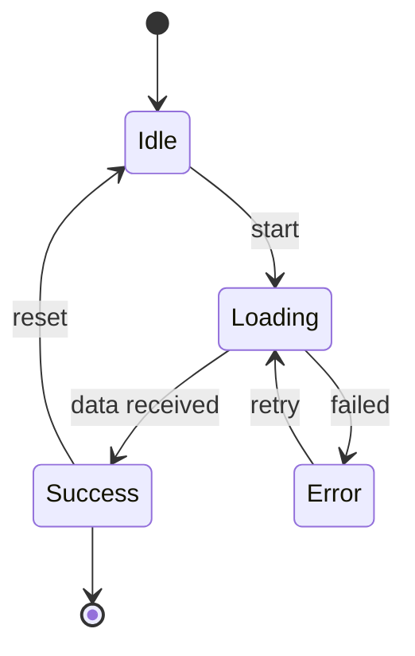
````

### Class Diagrams

Document object-oriented designs:

````markdown
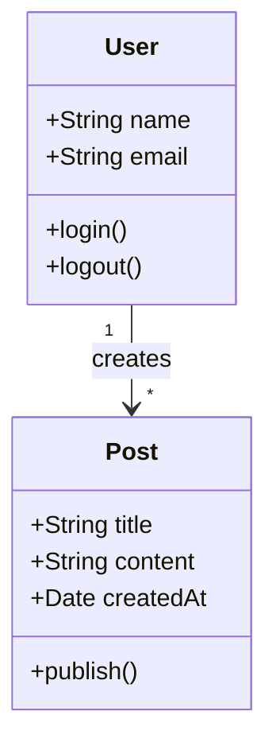
````

### Pie Charts

Display proportional data:

````markdown
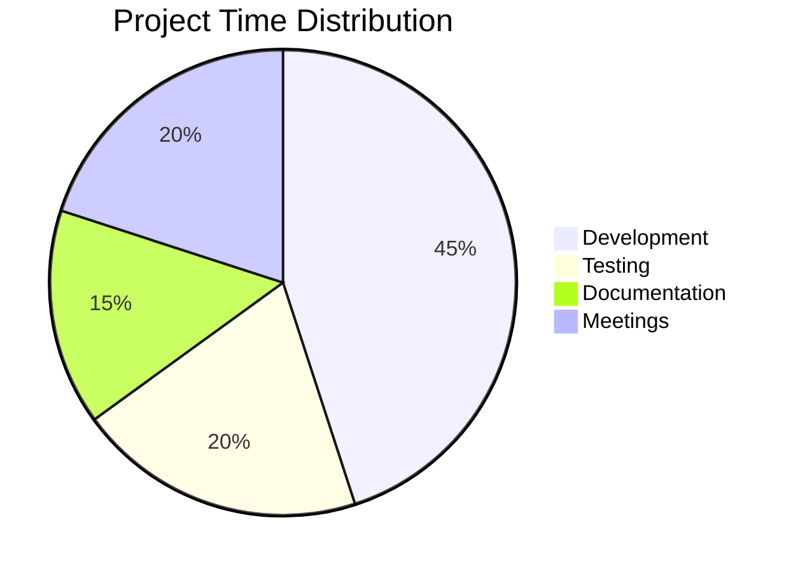
````

### Gantt Charts

Plan and track project timelines:

````markdown
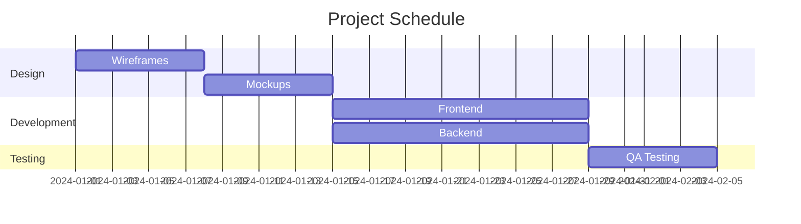
````

### Entity Relationship Diagrams

Model database relationships:

````markdown
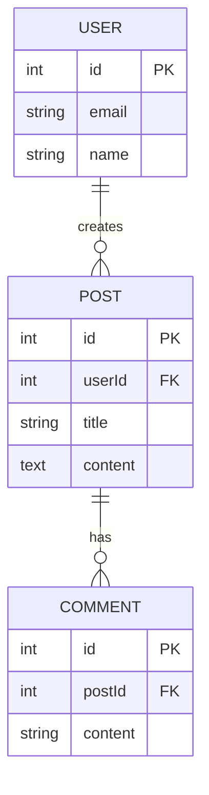
````

### Git Graphs

Visualize Git workflows:

````markdown
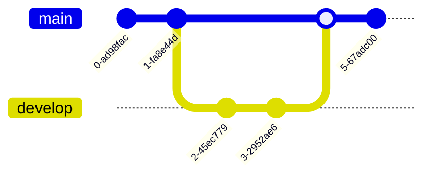
````

## Configuration

### Default Settings

The Mermaid plugin uses these defaults:

- `startOnLoad: false` - Diagrams render on demand
- `theme: "default"` - Mermaid's default theme
- `securityLevel: "strict"` - Secure rendering
- `fontFamily: "monospace"` - Consistent code-like typography
- `suppressErrorRendering: true` - Prevents partial renders on errors

> **Note:** `securityLevel: "strict"` is what keeps diagram labels safe: Mermaid sanitizes labels and disables click handlers, and Streamdown inserts the SVG that Mermaid returns as is. Your `mermaid.config` (or `createMermaidPlugin({ config })`) can override it, as upstream allows, because config comes from your code rather than from the Markdown. Don't set `securityLevel: "loose"` for untrusted content. See [Security](../security.md).

### Theme Customization

Customize the Mermaid theme using the `mermaid.config` prop:

<!-- example: examples/vite/src/snippets/plugins-mermaid/theme.tsx -->
```tsx
import { type MermaidConfig, mermaid } from "@solid-streamdown/mermaid";
import { Streamdown } from "solid-streamdown";

const config: MermaidConfig = {
  theme: "dark",
  themeVariables: {
    primaryColor: "#ff6b6b",
    primaryTextColor: "#fff",
    primaryBorderColor: "#ff6b6b",
    lineColor: "#f5f5f5",
    secondaryColor: "#4ecdc4",
    tertiaryColor: "#45b7d1",
  },
};

const markdown = "```mermaid\ngraph LR\n    A[Request] --> B[Response]\n```";

export default function Page() {
  return (
    <Streamdown mermaid={{ config }} plugins={{ mermaid }}>
      {markdown}
    </Streamdown>
  );
}
```

### Available Themes

Mermaid includes several built-in themes:

- `default` - Classic Mermaid theme
- `dark` - Dark mode optimized
- `forest` - Green tones
- `neutral` - Minimal styling
- `base` - Clean, modern style

Example:

<!-- example: examples/vite/src/snippets/plugins-mermaid/forest.tsx -->
```tsx
import { mermaid } from "@solid-streamdown/mermaid";
import { Streamdown } from "solid-streamdown";

const markdown = "```mermaid\ngraph LR\n    A[Seed] --> B[Tree]\n```";

export default function Forest() {
  return (
    <Streamdown mermaid={{ config: { theme: "forest" } }} plugins={{ mermaid }}>
      {markdown}
    </Streamdown>
  );
}
```

### Advanced Configuration

Customize specific diagram types:

<!-- example: examples/vite/src/snippets/plugins-mermaid/advanced-config.tsx -->
```tsx
import { mermaid } from "@solid-streamdown/mermaid";
import { Streamdown } from "solid-streamdown";

const markdown = "```mermaid\ngraph TD\n    A[Client] --> B[Server]\n    B --> C[Database]\n```";

export default function AdvancedConfig() {
  return (
    <Streamdown
      mermaid={{
        config: {
          theme: "base",
          themeVariables: {
            fontSize: "16px",
            fontFamily: "Inter, sans-serif",
          },
          flowchart: {
            nodeSpacing: 50,
            rankSpacing: 50,
            curve: "basis",
          },
          sequence: {
            actorMargin: 50,
            boxMargin: 10,
            boxTextMargin: 5,
          },
        },
      }}
      plugins={{ mermaid }}
    >
      {markdown}
    </Streamdown>
  );
}
```

### Factory Function

For advanced configuration, use `createMermaidPlugin`:

<!-- example: examples/vite/src/snippets/plugins-mermaid/factory.tsx -->
```tsx
import { createMermaidPlugin } from "@solid-streamdown/mermaid";
import { Streamdown } from "solid-streamdown";

const mermaid = createMermaidPlugin({
  config: {
    theme: "dark",
    fontFamily: "monospace",
  },
});

const markdown = "```mermaid\nsequenceDiagram\n    User->>App: Hello\n    App-->>User: Hi\n```";

export default function Factory() {
  return <Streamdown plugins={{ mermaid }}>{markdown}</Streamdown>;
}
```

Renders run one at a time. Each queued render uses the plugin that was current when it was requested, so swapping the `mermaid` plugin while a diagram renders applies to the next render; upstream keeps rendering with the plugin its loop started with. See [UPSTREAM.md](../../../UPSTREAM.md).

## Error Handling

### Custom Error Component

When Mermaid diagrams fail to render due to invalid syntax, you can provide a custom error component. This is useful for production environments where you want to control the user experience.

`mermaid.errorComponent` takes a Solid `Component<MermaidErrorComponentProps>`. Read its props from `props` (don't destructure them) so they stay reactive:

<!-- example: examples/vite/src/snippets/plugins-mermaid/error-component.tsx -->
```tsx
import { mermaid } from "@solid-streamdown/mermaid";
import type { Component } from "solid-js";
import { type MermaidErrorComponentProps, Streamdown } from "solid-streamdown";

const CustomMermaidError: Component<MermaidErrorComponentProps> = (props) => (
  <div class="rounded-lg border border-amber-200 bg-amber-50 p-4">
    <p class="font-semibold text-amber-900">Couldn't render diagram</p>
    <p class="mt-2 text-amber-700 text-sm">
      There was an issue with the diagram syntax.
    </p>
    <button
      class="mt-3 rounded bg-amber-600 px-4 py-2 text-sm text-white hover:bg-amber-700"
      onClick={() => props.retry()}
      type="button"
    >
      Try Again
    </button>
  </div>
);

const markdown = "```mermaid\ngraph TD\n    A[Parse] --> B[Render]\n```";

export default function Page() {
  return (
    <Streamdown
      mermaid={{ errorComponent: CustomMermaidError }}
      plugins={{ mermaid }}
    >
      {markdown}
    </Streamdown>
  );
}
```

The error component receives three props:

| Prop | Type | Description |
|------|------|-------------|
| `error` | `string` | The error message from Mermaid |
| `chart` | `string` | The original Mermaid diagram code |
| `retry` | `() => void` | Function to retry rendering the diagram |

The error component (or the built-in error message) shows only when there is no diagram to display: a chart that stops parsing keeps showing the last diagram that rendered.

### Example: Logging Errors

<!-- example: examples/vite/src/snippets/plugins-mermaid/error-logging.tsx#component -->
```tsx
const ErrorWithLogging: Component<MermaidErrorComponentProps> = (props) => {
  createEffect(() => {
    // Log to your error tracking service
    console.error("Mermaid rendering failed:", props.error);
    // Could also send to Sentry, LogRocket, etc.
  });

  return (
    <div class="p-4 text-center">
      <p class="text-muted-foreground">Unable to display diagram</p>
      <button class="mt-2 text-primary text-sm underline" onClick={() => props.retry()} type="button">
        Retry
      </button>
    </div>
  );
};
```

## Interactive Controls

Each Mermaid diagram includes interactive controls:

### Fullscreen Mode

Click the fullscreen button to view the diagram in an overlay with a dark background. This is useful for complex diagrams.

### Download

Download the diagram as SVG, PNG, or Mermaid source. By default files are named `diagram.svg`, `diagram.png`, and `diagram.mmd`. Pass `download: { filename: "flowchart" }` to use a custom base name.

### Copy

Copy the diagram source to your clipboard for pasting into other applications. Pass callbacks through `controls.mermaid.copy` to react to success or failure without replacing the default button:

<!-- example: examples/vite/src/snippets/plugins-mermaid/copy-callbacks.tsx -->
```tsx
import { mermaid } from "@solid-streamdown/mermaid";
import { createSignal } from "solid-js";
import { Streamdown } from "solid-streamdown";

const markdown = "```mermaid\ngraph LR\n    A[Copy] --> B[Paste]\n```";

export default function CopyCallbacks() {
  const [status, setStatus] = createSignal("");

  return (
    <>
      <Streamdown
        controls={{
          mermaid: {
            copy: {
              onCopy: () => setStatus("Diagram copied"),
              onError: (error) => setStatus(error.message),
            },
          },
        }}
        plugins={{ mermaid }}
      >
        {markdown}
      </Streamdown>
      <p class="text-muted-foreground text-sm">{status()}</p>
    </>
  );
}
```

### Customizing Controls

You can customize which controls are shown. Pass a `ControlsConfig` (exported as a type from `solid-streamdown`) as the `controls` prop:

<!-- example: examples/vite/src/snippets/plugins-mermaid/controls.tsx#custom -->
```tsx
const customControls: ControlsConfig = {
  mermaid: {
    fullscreen: true,
    download: { filename: "flowchart" }, // flowchart.svg / flowchart.png / flowchart.mmd
    copy: true, // or { onCopy, onError } for callbacks
    panZoom: true, // Enable pan and zoom controls
  },
};
```

Or disable specific controls:

<!-- example: examples/vite/src/snippets/plugins-mermaid/controls.tsx#partial -->
```tsx
const partialControls: ControlsConfig = {
  mermaid: {
    fullscreen: true,
    download: false, // Hide download button
    copy: false, // Hide copy button
    panZoom: false, // Hide pan/zoom controls
  },
};
```

Or disable all Mermaid controls:

<!-- example: examples/vite/src/snippets/plugins-mermaid/controls.tsx#none -->
```tsx
const noMermaidControls: ControlsConfig = { mermaid: false };
```

The example these come from ([`controls.tsx`](../../../examples/vite/src/snippets/plugins-mermaid/controls.tsx)) switches between them with a signal: `controls` takes effect whenever it changes.

## Streaming Considerations

### Initial Render

While a Mermaid fence streams in, Streamdown's parser keeps the code block properly formatted, and the diagram renders from the chart received so far. A partial chart that does not parse yet leaves the last diagram that rendered in place.

### Avoid Continuous Re-rendering

Mermaid diagrams are expensive to render. While a fence streams, the built-in diagram runs one render at a time and, when it finishes, renders only the latest chart, skipping the ones that arrived in between. To show a placeholder instead until the closing fence arrives, wrap the default `code` component and check `useIsCodeFenceIncomplete()`, which returns an `Accessor<boolean>`:

<!-- example: examples/vite/src/snippets/plugins-mermaid/incomplete-fence.tsx -->
```tsx
import { mermaid } from "@solid-streamdown/mermaid";
import { Show } from "solid-js";
import {
  type DefaultComponents,
  defaultComponents,
  Streamdown,
  useIsCodeFenceIncomplete,
} from "solid-streamdown";

const MermaidAwareCode: DefaultComponents["code"] = (props) => {
  const isIncomplete = useIsCodeFenceIncomplete();
  const isMermaid = () => props.class?.includes("language-mermaid") ?? false;

  return (
    <Show
      fallback={<defaultComponents.code {...props} />}
      when={isMermaid() && isIncomplete()}
    >
      <div class="flex h-48 animate-pulse items-center justify-center rounded-lg bg-muted">
        <span class="text-muted-foreground">Loading diagram...</span>
      </div>
    </Show>
  );
};

const markdown = "```mermaid\ngraph TD\n    A[Stream] --> B[Diagram]\n```";

export default function IncompleteFence() {
  return (
    <Streamdown components={{ code: MermaidAwareCode }} plugins={{ mermaid }}>
      {markdown}
    </Streamdown>
  );
}
```

This shows a placeholder while the code block is streaming, then renders the Mermaid diagram only once the closing ` ``` ` is received — without waiting for the entire markdown stream to finish.

### Disable Interactions During Streaming

Use the `isAnimating` prop to disable interactive controls while content is streaming. Here `createMarkdownStream()` supplies both the content and the streaming flag:

<!-- example: examples/vite/src/snippets/plugins-mermaid/is-animating.tsx -->
```tsx
import { mermaid } from "@solid-streamdown/mermaid";
import { onCleanup } from "solid-js";
import { createMarkdownStream, Streamdown } from "solid-streamdown";

const chunks = ["```mermaid\n", "graph LR\n", "    A[Chunk] --> B[Chunk]\n", "    B --> C[Done]\n", "```"];

export default function IsAnimating() {
  const stream = createMarkdownStream();
  let next = 0;
  const timer = setInterval(() => {
    if (next < chunks.length) {
      stream.write(chunks[next++] as string);
    } else {
      stream.end();
      clearInterval(timer);
    }
  }, 300);
  onCleanup(() => clearInterval(timer));

  return (
    <Streamdown isAnimating={stream.isStreaming()} plugins={{ mermaid }}>
      {stream.content()}
    </Streamdown>
  );
}
```

This prevents users from interacting with incomplete diagrams.

## Syntax Reference

### Flowchart Links

```text
A --> B         // Arrow
A --- B         // Line
A -.-> B        // Dotted arrow
A ==> B         // Thick arrow
A -->|Label| B  // Labeled arrow
```

### Sequence Diagram Actors

```text
participant A as Alice
actor B as Bob
```

### Styling Nodes

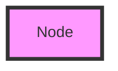

### Subgraphs

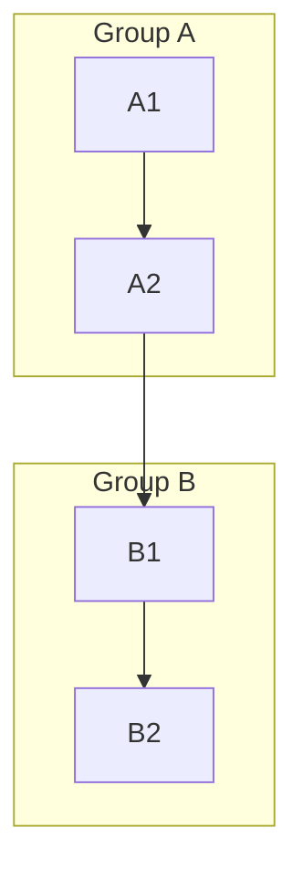

## Best Practices

### Keep Diagrams Focused

Break complex diagrams into smaller, focused visualizations:

````markdown
Good: Multiple small diagrams

## User Authentication Flow

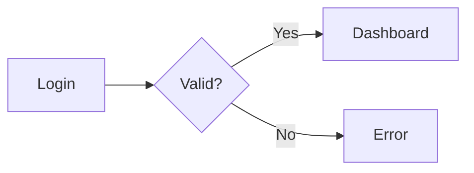

## Data Fetching Flow

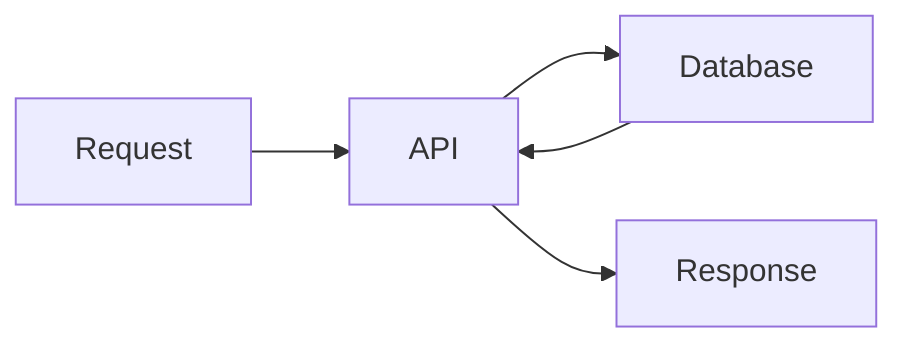

Avoid: One massive diagram with everything
````

### Add Context

Provide descriptions for your diagrams:

````markdown
Here's the authentication flow for our application:

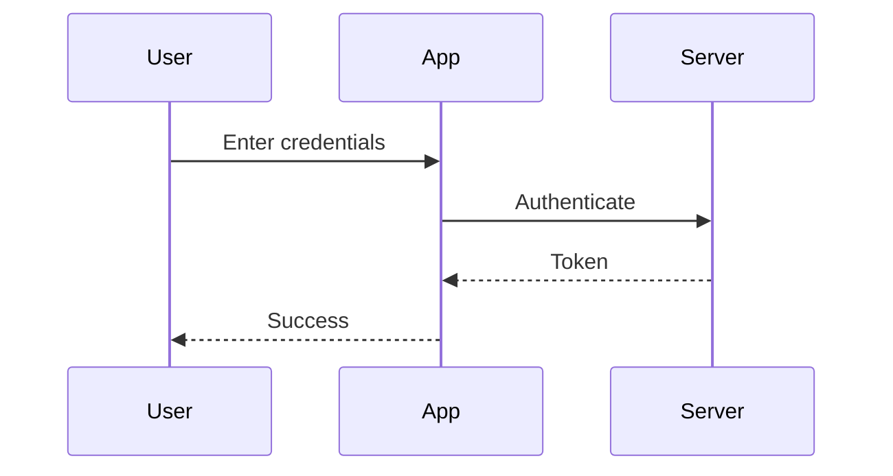

The server validates credentials and returns a JWT token.
````

### Use Descriptive Labels

Make your diagrams self-documenting:

````markdown
Good: Clear labels

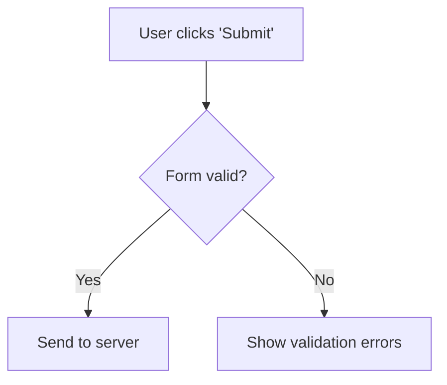

Avoid: Cryptic labels

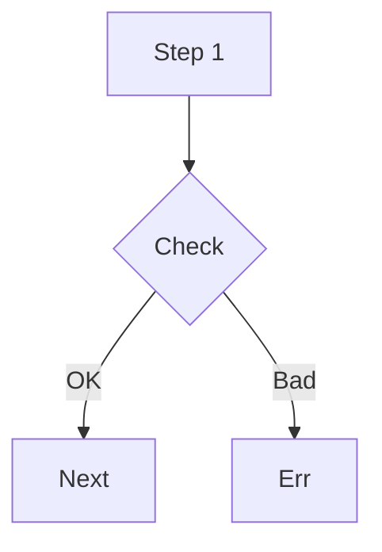
````

### Choose the Right Diagram Type

Select the diagram type that best represents your information:

- **Flowchart** - Processes, algorithms, workflows
- **Sequence** - API interactions, communication flows
- **State** - Lifecycle, state machines
- **Class** - Object relationships, architecture
- **ER** - Database schemas
- **Gantt** - Project timelines
- **Pie/Bar** - Statistical data

## Common Issues

### Diagram Not Rendering

1. Verify the Mermaid plugin is passed to Streamdown
2. Verify the syntax is correct (check [Mermaid Live Editor](https://mermaid.live/))
3. Ensure the code block uses ` ```mermaid `
4. Check browser console for JavaScript errors

### Performance with Large Diagrams

Large diagrams may take time to render. Consider:

- Breaking into smaller diagrams
- Simplifying node relationships
- Using subgraphs for organization
- Lazy loading diagram-heavy pages

Diagrams outside the viewport wait to render until they scroll near it.

### Theme Not Applying

1. Verify `mermaid.config` is properly passed
2. Check that theme name is spelled correctly
3. Ensure custom theme variables are valid

## Plugin Interface

The Mermaid plugin implements the `DiagramPlugin` interface (exported as a type from `solid-streamdown`):

| Field | Type | Description |
|-------|------|-------------|
| `name` | `"mermaid"` | Plugin name |
| `type` | `"diagram"` | Plugin type |
| `language` | `string` | `"mermaid"` |
| `getMermaid` | `(config?: MermaidConfig) => MermaidInstance` | Returns the Mermaid instance, initialized with the config when one is given |

The `language` property indicates which code block language triggers diagram rendering.

## Resources

- [Mermaid Documentation](https://mermaid.js.org/intro/) - Official docs
- [Mermaid Live Editor](https://mermaid.live/) - Test diagrams online
- [Syntax Reference](https://mermaid.js.org/intro/syntax-reference.html) - Complete syntax guide
- [Mermaid Examples](https://mermaid.js.org/ecosystem/integrations.html) - Gallery of examples

## Related Features

- [Code Blocks](../code-blocks.md) - Syntax highlighting for other code
- [GitHub Flavored Markdown](../gfm.md) - Extended Markdown features
- [Typography](../typography.md) - Text styling around diagrams
- [Unterminated Block Parsing](../termination.md) - How streaming works with Mermaid

## Differences from Streamdown

- Install commands use `bun add` and `npm i` with our package name.
- The Tailwind v3 `tailwind.config.js` samples are described in prose; the examples use Tailwind v4, and every JavaScript block in this guide must come from a checked example file.
- Samples are complete Solid components instead of JSX fragments. The theme sample uses the `MermaidConfig` type it imports (upstream imports it unused).
- `mermaid.errorComponent` takes a Solid `Component`; the samples read `props.error` and `props.retry` instead of destructuring, use `class`, and the logging sample uses `createEffect` instead of `useEffect`. The emoji in upstream's error sample is dropped. The error props are a table.
- The copy-callback sample sets a signal where upstream calls a `toast` library.
- The controls samples are `ControlsConfig` objects inside one component that switches between them, instead of three JSX fragments.
- "Avoid Continuous Re-rendering": upstream's sample renders an unexported `Mermaid` component from a `children` prop. Ours wraps the exported `defaultComponents.code` and reads the `Accessor` that `useIsCodeFenceIncomplete()` returns. The paragraph also describes the built-in one-render-at-a-time behaviour.
- "Initial Render": upstream says a streaming diagram appears as a code block until the syntax is complete; this page describes what the diagram component does (render the latest chart, keep the last diagram that rendered).
- The `isAnimating` sample streams with `createMarkdownStream()`.
- New notes describe deviations listed in [UPSTREAM.md](../../../UPSTREAM.md): the diagram component imported without `lazy()` (so no skeleton fallback), and each queued render using its current plugin. The note on `securityLevel` and the line about deferring off-screen diagrams describe behaviour shared with upstream.
- The flowchart-link and actor syntax listings are fenced as `text`; emoji markers in "Best Practices" are plain words.
- The `DiagramPlugin` interface listing is a table.
